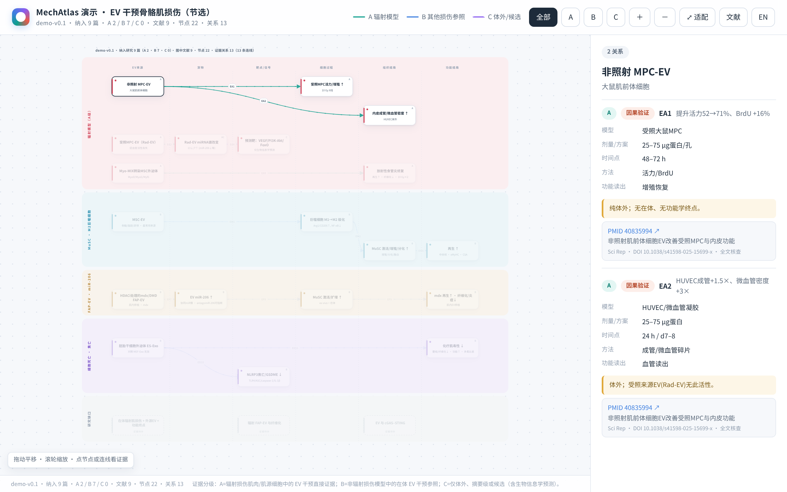
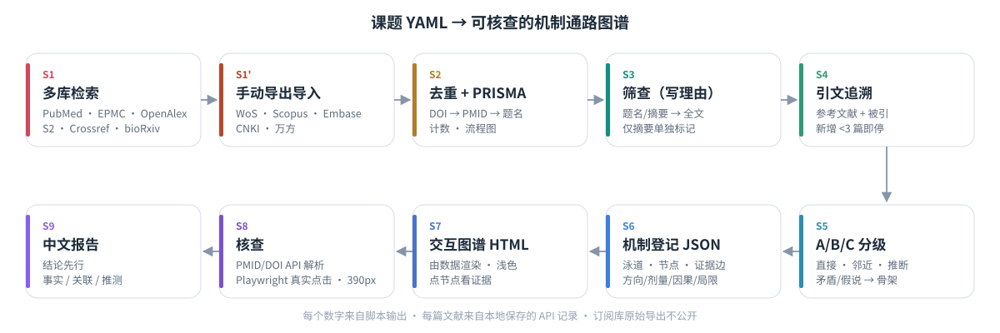
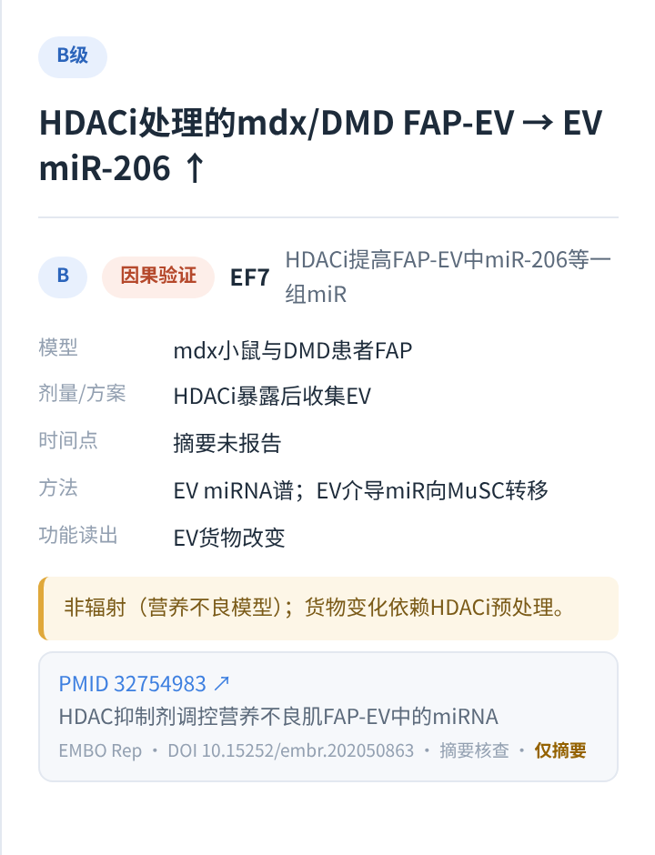
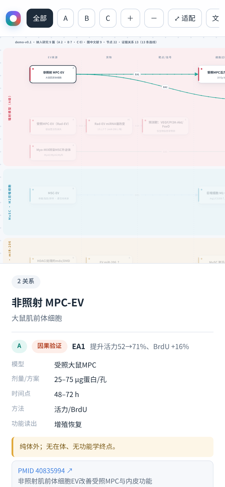

<p align="center">
  <a href="https://tuanziding.github.io/MechAtlas/"></a>
</p>

<h1 align="center">机制图谱 · MechAtlas</h1>

<p align="center">
  <strong>把一个生物医学课题，变成一张每条连线都查得到原文的信号通路图。</strong><br>
  An agent skill that turns a biomedical topic into a verified, evidence-graded, interactive pathway atlas.
</p>

<p align="center">
  给 Codex / Claude Code 用：多库系统检索 → 去重与 PRISMA → 带理由的筛查 → A/B/C 分级 → 机制登记 JSON → 浅色交互图谱 → API 与真实点击核查 → 中文报告。<br>
  For Codex / Claude Code: high-recall search, dedupe, PRISMA, screening with reasons, A/B/C grading, registry JSON, single-file atlas, verification, Chinese report.
</p>

<p align="center">
  <a href="README.md">简体中文</a> · <a href="docs/english-readme-v0.1.md">English</a> · <a href="https://tuanziding.github.io/MechAtlas/">在线演示 Live demo</a>
</p>

<p align="center">
  <a href="https://github.com/TUANZIDING/MechAtlas/actions"></a>
  <a href="LICENSE"></a>
  <a href="docs/demo/verify-refs-v0.1.json"></a>
  <a href="docs/demo/validation-v0.1.json"></a>
  
</p>

<p align="center">
  <code>不编造文献</code> · <code>闸门 + 有界重试 + 人工审批</code> · <code>6 个开放库 + 5 类手动导出</code> · <code>PRISMA 计数与流程图</code> · <code>由 JSON 渲染，不用图像模型</code> · <code>Playwright 真实点击</code> · <code>390 px 手机端</code>
</p>

<p align="center">
  <a href="#use-cases">使用场景</a> ｜ <a href="#workflow">怎么走</a> ｜ <a href="#showcase">图谱一览</a> ｜ <a href="#quick-start">快速开始</a> ｜ <a href="#structure">目录</a> ｜ <a href="#evidence">证据规则</a> ｜ <a href="#capabilities">能力状态</a> ｜ <a href="#license">许可与引用</a>
</p>

<p align="center"><sub>顶部大图为 <a href="https://tuanziding.github.io/MechAtlas/">演示页</a> 的真实截图（Playwright，浅色主题，2× 分辨率），不是示意图。演示数据节选自作者的 <a href="https://github.com/TUANZIDING/radiation-muscle-pathway">radiation-muscle-pathway</a> 项目，9 篇均为真实文献，PMID/DOI 已在线核对。</sub></p>

> ⚠️ **仅用于科研与教学。** 证据等级描述的是"在多像目标课题的模型里测到"，不等同人体临床因果，不能作为诊疗依据。

---

<a id="use-cases"></a>

## 从你的问题进入 · Use cases

| 你想做什么 | 可以怎样开始 |
| --- | --- |
| "X 通过哪些通路导致 Y？"想系统查一遍而不是凭印象 | 复制 [课题模板](config/topic-template-v0.1.yaml)，把 [Codex 提示词](prompts/codex-prompt-v0.1.md) 粘给 Agent |
| 写综述或标书前，要一张能逐条点开看原文的机制图 | 按 [工作流程](docs/guide-workflow-v0.1.md) 走到 S7，`docs/<课题>.html` 单文件可离线打开 |
| 已经有一批 Web of Science / 知网导出，想去重、筛查、出 PRISMA | [导入手动导出](docs/guide-wos-export-v0.1.md) → `run-search` → `prisma` |
| 想知道哪些机制"其实没有证据" | 看骨架节点（灰色虚框）与报告里的"研究缺口"，规则见 [分级指南](docs/guide-grading-v0.1.md) |
| 审稿或复核别人的通路图 | 把对方的边写成登记 JSON，跑 `verify-refs` 与 `validate-registry`，查不到的 PMID 一眼可见 |
| 了解两个完整案例 | [辐射肌损伤 v0.7](https://tuanziding.github.io/radiation-muscle-pathway/) · [EV 干预 v0.2](https://tuanziding.github.io/radiation-muscle-pathway/ev-intervention-v0.2.html)，配置见 [`examples/`](examples/) |

<a id="workflow"></a>

## 一个课题怎么走 · Workflow

<p align="center">
  
</p>

人（或 Agent）只做三件要判断的事：**筛查、分级、画机制关系**。其余——检索、分页、限流重试、去重、计数、构建、核查——都由脚本完成，并留下可复现的文件。完整步骤见 [docs/guide-workflow-v0.1.md](docs/guide-workflow-v0.1.md)，Agent 规则见 [AGENTS.md](AGENTS.md) 与 [SKILL.md](SKILL.md)。

### 每一步都有闸门，关键处停下来等人

一次真实课题（脊髓损伤机制图谱，纳入 137 篇）暴露过几个问题：OpenAlex 被限流返回 0 条，流程照样往下走；137 篇纳入只画出 32 条关系，剩下的去了哪里没有交代；有一条边因为"布局放不下"没画、两个节点被并在一起，核查却全部通过；66 篇仅读摘要，没人去找开放全文。

所以现在整个课题由 `scripts/pipeline-v0.1.py` 推进，每个环节都有闸门，过不了就有限次自动重试，再不行就停下来交给人：

- **检索**：某个库报错，只重跑失败的检索式，等待逐次拉长（约 1、5、15 分钟），最多 3 次；仍失败就请你选择跳过、改检索式或换数据源，报告里会写明，不会悄悄略过。请求成功但 0 命中不重试，直接请你确认（可能是真实的证据空白）。
- **提取覆盖**：每篇纳入研究要么进入至少一条证据边，要么写明不画的科学理由（"布局放不下"不算）；比例不够就让 Agent 补提取，最多 2 轮。
- **渲染一致性**：图谱画出来后与登记表逐条核对，少一条、多一条、端点或等级不对都算失败；布局冲突就自动重排（只挪位置，不删边、不并节点），最多 3 次。
- **全文升级**：仅读摘要的研究自动去 Europe PMC / Unpaywall 找开放全文，Agent 重读后提出改级，再走一轮复核；外层循环最多 2 轮。

需要你拍板的只有四处：**(a)** 检索前冻结检索策略和纳排标准；**(b)** 任何闸门把重试用完；**(c)** 每一处等级变更、删边、节点合并（逐条列出）；**(d)** 对外发布前。流水线停下时会写一份 `pending-approval-v0.1.md`，说明要决定什么、怎么记录；你决定后它从停下的地方接着走。去重、引用核查、schema 检查等其余环节全自动。每个闸门的结果都记在机器可读的 `run-state-v0.1.json` 里，并汇总进中文报告。重试次数、等待时间、阈值都在课题 YAML 的 `loop:` 段里改。

<a id="showcase"></a>

## 图谱一览 · Showcase

<table>
<tr>
<td width="50%" align="center" valign="top"><a href="https://tuanziding.github.io/MechAtlas/"></a><br><sub><b>点连线看证据</b>：等级、因果验证、模型、剂量、时间点、解释边界、PubMed 链接；只读摘要的来源标"仅摘要"<br>Click an edge: grade, causal test, model, dose, boundary, PubMed</sub></td>
<td width="50%" align="center" valign="top"><a href="https://tuanziding.github.io/MechAtlas/"></a><br><sub><b>手机 390 px</b>：无横向溢出，点节点即开证据面板<br>Mobile 390 px, tap a node for evidence</sub></td>
</tr>
</table>

演示页（[在线](https://tuanziding.github.io/MechAtlas/) · [`docs/index.html`](docs/index.html)）由 [`examples/demo/registry-demo-v0.1.json`](examples/demo/registry-demo-v0.1.json) 构建：4 个机制泳道 + 1 个缺口泳道、22 个节点（3 个骨架）、13 条证据关系、9 篇纳入研究（A 2 / B 7）。完整图谱：

- **辐射致骨骼肌损伤分子通路图谱 v0.7**：<https://tuanziding.github.io/radiation-muscle-pathway/>（纳入 53 篇，A 15 / B 26 / C 12）
- **EV 干预骨骼肌损伤通路图 v0.2**：<https://tuanziding.github.io/radiation-muscle-pathway/ev-intervention-v0.2.html>（纳入 141 篇，A 2 / B 120 / C 19）

<a id="quick-start"></a>

## 先用起来 · Quick start

**让 Agent 做：** 打开 [prompts/codex-prompt-v0.1.md](prompts/codex-prompt-v0.1.md)，先按说明**打开 Codex 的网络**（CLI 默认关闭：`~/.codex/config.toml` 里 `[sandbox_workspace_write] network_access = true`；Codex Cloud 在环境里开 Agent internet access），再把提示词粘进去，把【】换成你的课题。

**自己跑：**

```bash
git clone https://github.com/TUANZIDING/MechAtlas.git && cd MechAtlas
pip install -r requirements.txt                  # 只需 PyYAML；HTTP 用标准库
export MECHATLAS_EMAIL=you@example.org           # API 礼貌访问；可选 NCBI_API_KEY / OPENALEX_API_KEY / S2_API_KEY

python3 tests/run-tests-v0.1.py                  # 51 项离线测试
python3 scripts/run-search-v0.1.py examples/radiation-muscle/topic-v0.1.yaml --max 3 --only pubmed,europepmc   # 冒烟

# 你的课题
cp config/topic-template-v0.1.yaml config/my-topic-v0.1.yaml       # 填 PICO、检索式、泳道、分级、loop 重试参数
python3 scripts/pipeline-v0.1.py run config/my-topic-v0.1.yaml     # 反复运行；停下时看 runs/my-topic/pending-approval-v0.1.md
python3 scripts/pipeline-v0.1.py approve runs/my-topic --checkpoint freeze-1 --decision approve --by 你的名字
python3 scripts/pipeline-v0.1.py status runs/my-topic

# 图谱（Node 22 + Playwright）
npm install --no-save playwright && npx playwright install chromium
node scripts/build-atlas-v0.1.mjs --registry examples/demo/registry-demo-v0.1.json --studies examples/demo/studies-demo-v0.1.json --out docs/index.html
node scripts/verify-atlas-v0.1.mjs                # 32 项真实点击检查（含逐条一致性）
python3 scripts/verify-refs-v0.1.py examples/demo/registry-demo-v0.1.json   # 在线解析每个 PMID/DOI
```

`make test`、`make demo`、`make verify`、`make shots`、`make refs`、`make smoke` 是同样的快捷方式；已装系统 Chromium 时加 `CHROMIUM_PATH=/usr/bin/chromium`。

<a id="structure"></a>

## 目录 · Structure

```
MechAtlas/
├── SKILL.md · AGENTS.md · CLAUDE.md     # 技能入口（镜像到 .agents/skills/ 与 .claude/skills/）+ 底线规则
├── config/topic-template-v0.1.yaml      # 课题配置：PICO、纳入排除、各库检索式、泳道、分级
├── examples/
│   ├── radiation-muscle/topic-v0.1.yaml # 辐射肌损伤 v0.7 的真实检索式（12 条）
│   ├── ev-intervention/topic-v0.1.yaml  # EV 干预 v0.1/v0.2 的真实检索式
│   └── demo/                            # 演示登记表 + 9 篇纳入研究（真实 PMID）
├── scripts/
│   ├── search-{pubmed,europepmc,openalex,crossref,semanticscholar,biorxiv}-v0.1.py
│   ├── snowball-openalex-v0.1.py        # 引文追溯（OpenAlex 或 --backend s2）
│   ├── pipeline-v0.1.py                 # 闸门流水线：有界重试、外层循环、人工审批点、run-state
│   ├── gates-v0.1.py · relayout-v0.1.py # 检索/覆盖/渲染一致性/几何闸门；自动重排（只挪位置）
│   ├── fulltext-oa-v0.1.py              # 仅摘要研究的开放全文升级（Europe PMC / Unpaywall）
│   ├── run-search-v0.1.py               # 按 YAML 一键检索 + 导入 + 去重 + 筛查表
│   ├── import-export-v0.1.py            # 手动导出 → 统一记录
│   ├── dedupe · screen-sheet · prisma · verify-refs · validate-registry · report  (-v0.1.py)
│   ├── build-atlas · verify-atlas · shots-atlas  (-v0.1.mjs)
│   └── common-v0.1.py · check-repo-v0.1.py · draw-pipeline-v0.1.py
├── importers/                           # WoS 纯文本/制表符 · Scopus CSV · RIS(Scopus/Embase) · CNKI/万方 · 可选 API
├── schema/                              # record / study / registry / run-state 的 JSON Schema
├── templates/atlas-template-v0.1.html   # 通用浅色交互图谱模板
├── prompts/codex-prompt-v0.1.md         # 可直接粘贴的 Codex 提示词（含联网设置）
├── docs/                                # GitHub Pages：index.html 演示页 + 中文指南 + 截图 + 核查结果
└── tests/                               # 51 项离线测试 + 合成导出样例（非真实数据）
```

<a id="evidence"></a>

## 证据规则 · Evidence rules

| 规则 | 怎么保证 |
| --- | --- |
| 不编造文献 | 纳入记录只能来自本地保存的 API 记录；`verify-refs` 用 PubMed esummary / Crossref / doi.org 解析每个 PMID/DOI 并比对题名 |
| 每条边都有来源 | 构建脚本与 `validate-registry` 强制：边 → 来源卡 → 纳入研究，缺一即失败 |
| 纳入了就要有交代 | 覆盖闸门：每篇纳入研究进入证据边，或在 `unmapped` 写科学理由；布局不是理由 |
| 画出来的就是登记的 | 渲染一致性闸门：图谱与登记表逐条比对，删边、并节点、改等级都要人工逐条批准 |
| 读到多深要说清 | `abstract_only` 标"仅摘要"，最高 B 级；A 级必须读全文 |
| 事实 / 关联 / 推测分开 | 边上 `causal` 只表示做过因果检验；报告每条结论标【事实】【关联】【推测】 |
| 矛盾与假说不画箭头 | 骨架节点（灰色虚框）不连证据边 |
| 图不是画出来的 | 页面由 JSON + 模板渲染，统计数字由数据计算；禁止用图像模型生成通路图 |
| 订阅数据不外泄 | `inputs/`、`runs/` 已 gitignore；只发布标识符与筛查判定 |

默认分级：**A** 目标课题的直接模型 · **B** 邻近/非目标模型或条件性、仅摘要 · **C** 推断/候选/间接；每个课题可改写定义。详见 [分级指南](docs/guide-grading-v0.1.md)。

<a id="capabilities"></a>

## 当前做到哪一步 · Capability status

| 状态 | 内容 | 实际边界 |
| --- | --- | --- |
| 已验证 · 在线 | PubMed、Europe PMC（含预印本）、Semantic Scholar、Crossref、bioRxiv 检索脚本；一键运行器；引文追溯（S2 后端）；引用核查 | 2026-11-01 用小样本在线跑通；Semantic Scholar 匿名池常限流，脚本退避重试 |
| 已实现 · 受限 | OpenAlex 检索与引文追溯 | 2026 起匿名访问按 IP 计日预算，测试当天共享 IP 预算已用完（HTTP 429）；**请设 `OPENALEX_API_KEY`** |
| 已验证 · 离线 | WoS（纯文本、UTF-16 制表符）、Scopus CSV/RIS、Embase RIS、CNKI/万方 RefWorks/EndNote/NoteExpress 导入；去重；PRISMA；筛查表；schema 与证据契约 | 用合成样例测试，未用真实导出回归 |
| 已验证 · 浏览器 | 图谱构建、32 项真实点击验证（含逐条一致性）、截图 | 初始布局坐标仍需人工安排；冲突时自动重排只挪行号 |
| 已验证 · 离线 | 闸门流水线：检索重试与退避、覆盖闸门、渲染一致性、自动重排、改动比对、四个人工审批点、run-state | 用合成数据与注入的检索/构建/全文接口测试；真实课题上待更多回归 |
| 已实现 · 未在线回归 | 开放全文升级（Europe PMC fullTextXML、Unpaywall） | 只取开放获取全文；出版社 PDF 可能拒绝下载，此时只记录链接 |
| 未测试 | WoS Starter API、Elsevier Scopus API 适配器 | 需用户自备 key |
| 不包含 | 自动筛查判定、订阅全文、机构订阅库的自动检索、代替人批准 | 判定由人/Agent 完成并写理由；订阅库只能手动导出；审批只能由人记录 |

## 参与共创 · Contribute

发现某个库的导出格式解析不对、检索脚本被限流、或分级口径有争议，欢迎开 [Issue](https://github.com/TUANZIDING/MechAtlas/issues)：请附脱敏后的几行样例（不要上传真实的整份导出）、命令与报错。

<a id="license"></a>

## 许可与引用 · License & citation

代码、模板与文档以 [MIT](LICENSE) 发布。演示数据中的文献题录来自 PubMed / Crossref 公开元数据，原文版权归作者和出版社所有。引用本项目请见 [CITATION.cff](CITATION.cff)；更新记录见 [CHANGELOG.md](CHANGELOG.md)。

<details>
<summary><strong>数据许可提醒 / Data licensing</strong></summary>

Web of Science（Clarivate）、Scopus 与 Embase（Elsevier）、CNKI/万方的检索结果与导出文件受各自许可协议约束，不得提交到本仓库或公开网页。MechAtlas 只发布标识符（PMID、DOI、WoS UT、Scopus EID）与你的筛查判定。`tests/fixtures/` 里是人工编写的合成样例，不是真实导出。

</details>

---

<p align="center">
  <strong>机制图谱 · MechAtlas</strong><br>
  每一条箭头，都要能点开看到原文。<br>
  <a href="https://github.com/TUANZIDING">TUANZIDING</a> · 丁海祥 Haixiang Ding, MD · Emergency and Trauma Surgeon · PhD Candidate in Clinical Medicine, Soochow University
</p>

<sub>本仓库内容仅用于学习与研究，不构成临床或实验操作建议。</sub>
